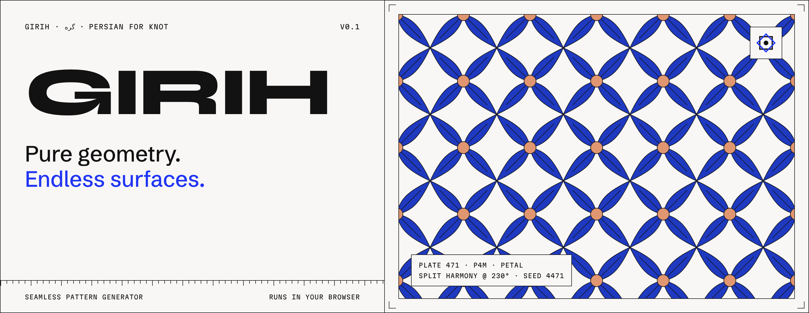
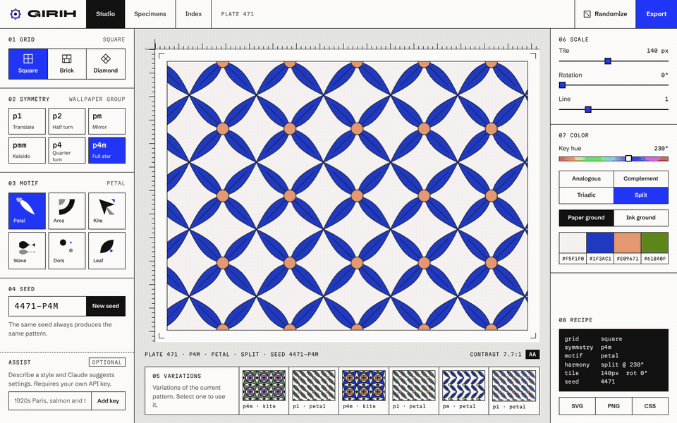
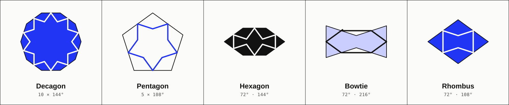
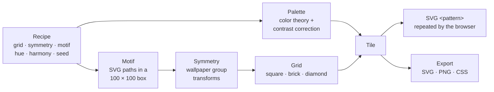

<p align="center">
  
</p>

<p align="center">
  <a href="https://gabrielasu.github.io/girih/"></a>
  <a href="docs/ARCHITECTURE.md"></a>
  
  
  <a href="LICENSE"></a>
</p>

Girih is a seamless pattern generator. You set four dials, a grid, a symmetry, a motif and a color rule, and the surface builds itself in real time. Everything runs in the browser. There is no account, no server, and no AI required.

<p align="center">
  
</p>
<p align="center"><sub>THE STUDIO, RECORDED LIVE · NO AI INVOLVED</sub></p>

<br />

## Four dials

Every pattern in Girih is a recipe. The same recipe always produces the same pattern, so any design can be saved, linked and rebuilt exactly.

| Dial            | Options                                                             | What it does                                                                            |
| --------------- | ------------------------------------------------------------------- | --------------------------------------------------------------------------------------- |
| **01 Grid**     | square · brick · diamond                                            | How the tile repeats across the surface                                                 |
| **02 Symmetry** | `p1` `p2` `pm` `pmm` `p4` `p4m`                                     | Wallpaper groups that copy one motif into a full tile by translation, mirrors and turns |
| **03 Motif**    | petal · arcs · kite · wave · dots · leaf                            | The mark itself, drawn so it meets its neighbours cleanly at every edge                 |
| **04 Color**    | key hue + analogous · complement · triadic · split, on paper or ink | A palette from color theory, with contrast measured and corrected automatically         |

<p align="center">
  
</p>

<br />

## Girih means knot

In Persian, _girih_ (گره) means knot. The word names the geometric strapwork of Islamic architecture: interlacing lines that form stars and polygons across walls, domes and doors.

Craftsmen built these patterns from five tiles, each crossed by lines that continue seamlessly into the next. In 2007, Peter Lu and Paul Steinhardt showed that the tilework of the Darb-i Imam shrine in Isfahan, built in 1453, is nearly quasicrystalline: ordered, but never exactly repeating. Western mathematics described that kind of structure in the 1970s.

This app is named after that tradition: a small set of rules, applied with care, producing surfaces without end.

<p align="center">
  
</p>
<p align="center"><sub>The five girih tiles, drawn by the same construction the craftsmen used: every line leaves an edge midpoint at 54°.</sub></p>

<br />

## Features

- **Studio.** Build patterns from 3 grids, 6 symmetry groups, 6 motifs, 4 color harmonies, tile size, rotation, line weight and a seed.
- **Variations.** Six seeded variations of the current pattern, one click to adopt and keep exploring.
- **Shareable links.** The full recipe lives in the URL. Send a link, get the exact pattern back.
- **Accessible color.** Palettes are corrected toward a minimum contrast, and the Studio shows the WCAG ratio with an AA badge.
- **Export.** A seamless SVG tile, a PNG at 2x or 4x, or a CSS background you can paste anywhere.
- **Specimens.** A gallery of example plates, each one opens in the Studio.
- **Optional Claude assist.** Describe a style in words and Claude suggests settings, using your own API key. See [below](#optional-claude-assist).

## Quick start

Requires Node 22.

```bash
git clone https://github.com/Gabrielasu/girih.git
cd girih
npm ci
npm run dev   # http://localhost:5173
```

## How it works



The engine in [`src/engine`](src/engine) is pure TypeScript with no React or DOM imports, enforced by lint rules. Given a recipe it returns plain data: a tile size, a background and a list of painted paths. React renders that as an SVG `<pattern>`, so the browser handles the repetition natively and the canvas stays smooth while you drag a slider.

1. **Palette.** The key hue and harmony produce four colors. The primary color is darkened on paper and lightened on ink, in small steps, until it reaches a 3.2:1 contrast against the ground.
2. **Motif.** Each motif is a few SVG paths in a 100 × 100 box, each tagged with a palette role.
3. **Symmetry.** The tile is split into quadrants, and the wallpaper group assigns each one a transform: identity, mirror, half turn or quarter turn. `p4m` adds a diagonal mirror for eightfold symmetry.
4. **Grid.** Square repeats one block, brick offsets every other row by half a tile, diamond turns the square grid 45°.
5. **Seed.** A seeded Mulberry32 generator drives the variations and the plate number, so results are reproducible.

More detail in [docs/ARCHITECTURE.md](docs/ARCHITECTURE.md).

## Optional Claude assist

Girih works fully without AI. If you want suggestions, type a style such as _"1920s Paris café floor, salmon and teal"_ into the Assist box in the Studio and add your own [Anthropic API key](https://console.anthropic.com/).

- The key is stored only in your browser and sent only to `api.anthropic.com`. It is never logged.
- Claude returns a JSON recipe that is validated with zod. You see the proposed changes and choose whether to apply them.
- Claude only turns the same dials you can turn by hand. It never draws the pattern.
- The model id lives in [`src/features/assist/config.ts`](src/features/assist/config.ts).

## Project structure

```
src/
  engine/      pure TypeScript pattern engine (100% test coverage)
  features/    studio · specimens · landing · assist · export
  components/  shared UI primitives
  styles/      design tokens, fonts, global styles
  lib/         URL state, storage, helpers
  app/         router, layout, config
```

| Script                                  | What it does                      |
| --------------------------------------- | --------------------------------- |
| `npm run dev`                           | Start the dev server              |
| `npm run build`                         | Type check and build to `dist/`   |
| `npm test`                              | Unit and component tests (Vitest) |
| `npm run test:e2e`                      | Browser tests (Playwright)        |
| `npm run lint` · `typecheck` · `format` | Code quality checks               |
| `npm run screenshots`                   | Capture `docs/screenshots/`       |

To regenerate the README artwork from the engine: `npx tsx scripts/readme-assets.ts && node scripts/readme-banner.mjs`.

## Credits

- Typefaces: [Syne](https://fonts.google.com/specimen/Syne), [Schibsted Grotesk](https://fonts.google.com/specimen/Schibsted+Grotesk) and [Martian Mono](https://fonts.google.com/specimen/Martian+Mono), self hosted with [Fontsource](https://fontsource.org/), SIL Open Font License.
- Peter J. Lu and Paul J. Steinhardt, "Decagonal and Quasi-Crystalline Tilings in Medieval Islamic Architecture", _Science_, 2007.

<br />

<p align="center">
  <sub>Built by Gabi · <a href="https://x.com/gabigebis">@gabigebis</a> · <a href="LICENSE">MIT</a></sub>
</p>
